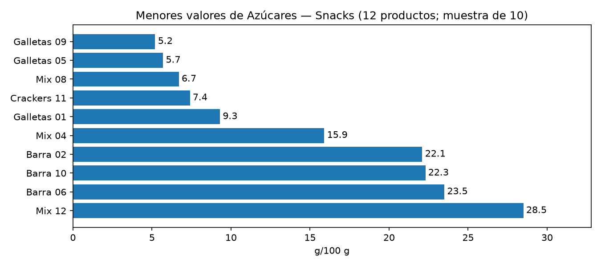
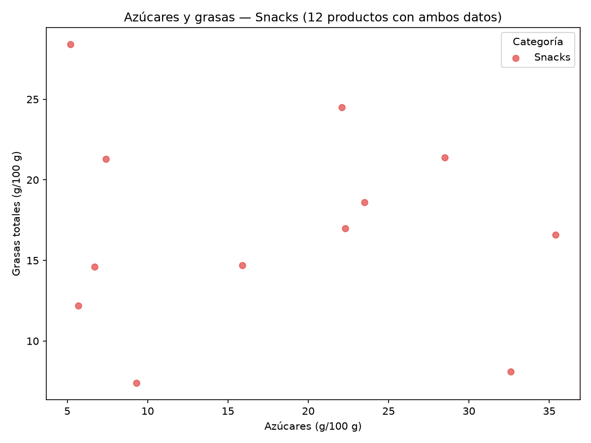
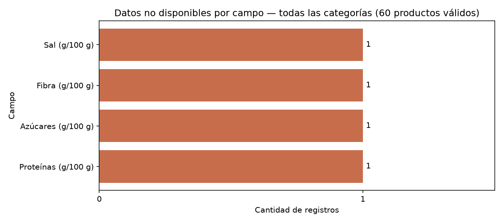
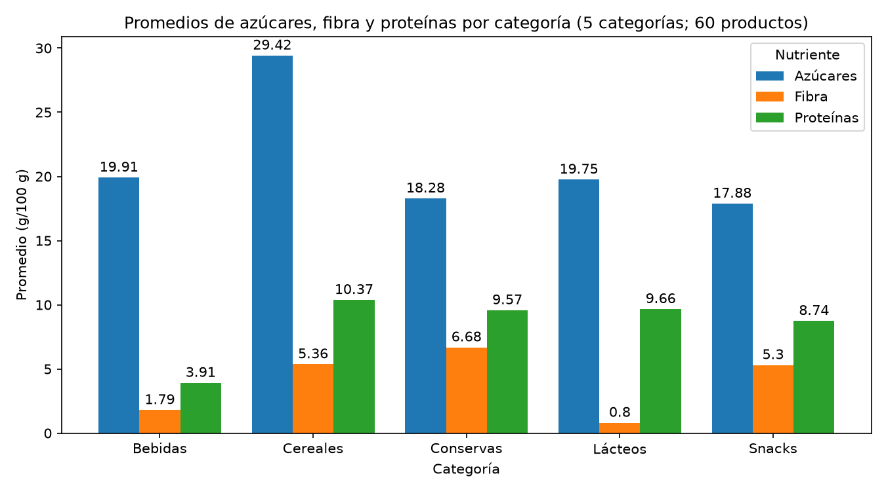
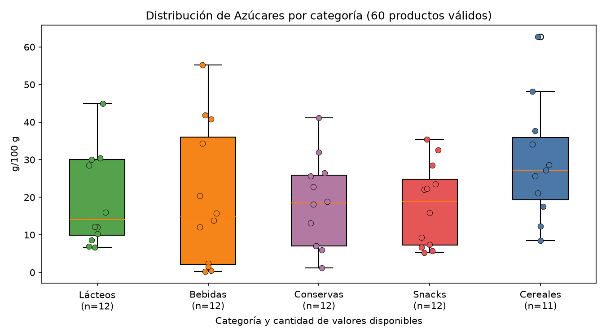
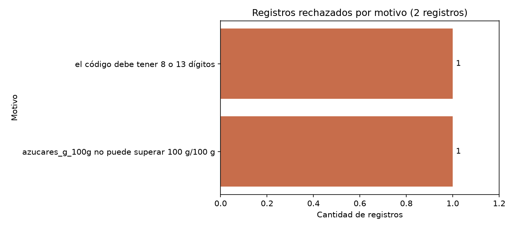

# Comparador de etiquetas nutricionales

**Autor:** Santiago Narbe · **Materia:** Programación Orientada a Datos · **Trabajo:** TP2 individual

## Inicio rápido

Se requiere Python 3.10 o posterior. Desde la raíz del repositorio, prepara el entorno e instala las dependencias:

```bash
python -m venv .venv
source .venv/bin/activate
pip install -r requirements.txt
```

En Windows, activa el entorno con `.venv\Scripts\activate`. Ejecuta el análisis de ejemplo y las pruebas:

```bash
python -m src.main --entrada data/productos.csv --categoria Snacks --nutriente azucares
python -m unittest discover -s tests
```

La aplicación guarda cuatro tablas CSV y, salvo que se indique `--sin-graficos`, seis imágenes en `outputs/`. Esta carpeta se crea al ejecutar y no se versiona. Para leer el archivo JSON, reemplaza `data/productos.csv` por `data/productos.json`. Usa `--salida RUTA` para elegir otra carpeta.

## 1. Problema y solución

Las etiquetas nutricionales pueden expresar cantidades de formas distintas y un dato ausente no equivale a cero. Esta aplicación permite explorar y comparar productos usando una referencia común de 100 g. Se pueden filtrar por categoría, ordenar por nutriente y consultar resúmenes. Los valores ausentes se muestran como “no disponible” y los registros inválidos se informan con su motivo.

Es una herramienta educativa para probar un flujo de lectura, validación y análisis; no evalúa alimentos ni recomienda dietas.

## 2. Conjunto de prueba y formato de entrada

`data/productos.csv` y `data/productos.json` contienen el mismo conjunto de **prueba sintético**, generado con semilla fija. Los productos son ficticios y no representan alimentos reales. El conjunto incluye 60 registros válidos, cuatro nutrientes ausentes deliberadamente y dos registros inválidos para probar los rechazos. No se utilizan datos personales ni fuentes externas.

Cada registro representa un producto de prueba e incluye código, nombre, categoría, energía (kcal/100 g) y nutrientes (g/100 g). El código se trata como texto y se valida por formato de 8 o 13 dígitos; no se comprueba su dígito de control. CSV y JSON deben incluir todos los campos del esquema. Los valores nutricionales pueden estar vacíos (CSV) o ser `null` (JSON), pero no se deben omitir columnas ni claves. El esquema, las unidades y el procedimiento de generación se detallan en [data/README.md](data/README.md).

Las categorías disponibles son `Cereales`, `Bebidas`, `Lácteos`, `Snacks` y `Conservas`. Los nutrientes son energía, proteínas, carbohidratos, azúcares, grasas, grasas saturadas, fibra y sal. Para generar de nuevo ambos archivos de prueba:

```bash
python -m src.generar_datos
```

## 3. Organización del código

```text
.
├── README.md
├── .gitignore
├── requirements.txt
├── data/
│   ├── README.md
│   ├── productos.csv
│   └── productos.json
├── docs/                         # Gráficos de ejemplo incluidos en este README
│   ├── ejemplo_azucares_snacks.png
│   ├── grafico_azucares_vs_grasas.png
│   ├── grafico_datos_faltantes.png
│   ├── grafico_distribucion_categoria.png
│   ├── grafico_promedios_categoria.png
│   └── grafico_rechazos_por_motivo.png
├── src/
│   ├── __init__.py
│   ├── fuentes.py                # Lectura abstracta desde CSV o JSON
│   ├── generar_datos.py          # Generación del conjunto sintético de prueba
│   ├── graficos.py               # Generación de gráficos con matplotlib
│   ├── main.py                   # Argumentos y coordinación de la aplicación
│   ├── modelo.py                 # Dataclass ProductoNutricional
│   └── pipeline.py               # Validación, limpieza, comparación y resúmenes
├── tests/                        # Pruebas automatizadas con unittest
└── outputs/                      # Resultados de ejecución; no se versiona
```

El flujo de procesamiento es **leer → validar y limpiar → analizar → comunicar**. `FuenteCSV` y `FuenteJSON` comparten la interfaz `FuenteDatos`; `ProductoNutricional` modela cada ficha. El pipeline comprueba y compara los registros, mientras que `main.py` coordina los argumentos y las exportaciones. `graficos.py` genera las visualizaciones. Si la entrada no se puede leer, la aplicación informa el error sin mostrar un traceback.

Los archivos exportados a `outputs/` son:

| Archivo | Contenido |
|---|---|
| `comparacion.csv` | Productos válidos filtrados por categoría y ordenados por el nutriente elegido. |
| `rechazos.csv` | Registros descartados, su posición de entrada y el motivo. |
| `faltantes.csv` | Cantidad de valores ausentes por campo entre los productos válidos. |
| `resumen_categorias.csv` | Promedios de energía, azúcares, proteínas, fibra y sal por categoría. |
| `grafico_comparacion.png` | Hasta diez valores menores del nutriente elegido. |
| `grafico_azucares_vs_grasas.png` | Relación entre azúcares y grasas en los productos comparados. |
| `grafico_datos_faltantes.png` | Conteo de valores ausentes por campo. |
| `grafico_promedios_categoria.png` | Promedios de azúcares, fibra y proteínas por categoría. |
| `grafico_distribucion_categoria.png` | Distribución del nutriente elegido por categoría. |
| `grafico_rechazos_por_motivo.png` | Conteo de registros rechazados por motivo. |

### Conceptos aplicados y justificación

- **Funciones con responsabilidades acotadas:** lectura, normalización, limpieza, comparación, resúmenes y exportación están separadas para que cada etapa sea más fácil de probar.
- **Clases y abstracción:** una dataclass representa el producto y una interfaz común desacopla el análisis del formato de entrada.
- **Validación:** se comprueban campos obligatorios, formato de código, valores, rangos y duplicados antes de analizar.
- **Manejo de faltantes y errores:** los valores ausentes se conservan como nulos; los registros rechazados se acompañan de su motivo.
- **Pruebas automatizadas:** `unittest` verifica lectura, validación, pipeline, aplicación y gráficos sin modificar los archivos de prueba.

## 4. Decisiones de limpieza

| Situación | Decisión |
|---|---|
| Código inválido o duplicado | Rechazar y registrar el motivo; conservar la primera fila válida de cada código. |
| Nutriente faltante | Conservar como nulo y mostrar “no disponible”; nunca tratarlo como cero. |
| Valor fuera de rango o inconsistente | Rechazar el registro completo: nutrientes negativos o mayores a 100 g/100 g, energía mayor a 900 kcal/100 g, azúcares mayores que carbohidratos o grasas saturadas mayores que grasas totales. |

Los faltantes se excluyen solo de los cálculos que necesitan ese valor. Los resúmenes por categoría y el conteo de faltantes se calculan sobre productos válidos; los registros rechazados se informan por separado. En `rechazos.csv`, `registro` indica la posición de la fila en la entrada, empezando en 1. Estas son reglas didácticas de plausibilidad: no certifican cumplimiento regulatorio, ni imputan o modifican valores.

## 5. Ejemplo de resultado: gráficos

Este ejemplo ejecuta `python -m src.main --entrada data/productos.csv --categoria Snacks --nutriente azucares`:

```text
Registros leídos: 62
Productos válidos: 60
Registros rechazados: 2
Productos comparados: 12

Ordenados por azucares (menor a mayor):
       codigo      nombre categoria  azucares_g_100g
2000000000045 Galletas 09    Snacks              5.2
2000000000041 Galletas 05    Snacks              5.7
2000000000044      Mix 08    Snacks              6.7
2000000000047 Crackers 11    Snacks              7.4
2000000000037 Galletas 01    Snacks              9.3
2000000000040      Mix 04    Snacks             15.9
2000000000038    Barra 02    Snacks             22.1
2000000000046    Barra 10    Snacks             22.3
2000000000042    Barra 06    Snacks             23.5
2000000000048      Mix 12    Snacks             28.5
2000000000043 Crackers 07    Snacks             32.6
2000000000039 Crackers 03    Snacks             35.4
```

El gráfico de comparación muestra los diez menores valores del nutriente seleccionado. Cada barra representa gramos por 100 g y el valor aparece junto a ella. Una barra más larga indica un valor mayor, no una evaluación de salud.



La aplicación genera también las siguientes visualizaciones. Las imágenes que se muestran aquí se generaron con el conjunto de prueba incluido; al ejecutar el programa, los archivos se guardan en `outputs/`.

**Azúcares y grasas.** Cada punto representa un producto de prueba de Snacks con ambos valores disponibles. Describe este conjunto y no permite inferir una relación para alimentos reales.



**Datos no disponibles.** Resume los valores ausentes en los 60 productos de prueba válidos; no se imputan como cero.



**Promedios por categoría.** Compara los promedios de azúcares, fibra y proteínas entre las cinco categorías de prueba, en gramos por 100 g.



**Distribución por categoría.** El boxplot resume los valores disponibles de azúcares por categoría; los puntos muestran registros individuales y las etiquetas indican cuántos valores se usaron.



**Registros rechazados.** Agrupa los dos registros inválidos de prueba según el motivo del rechazo.



## 6. Limitaciones

Los resultados describen únicamente este conjunto de prueba sintético. Sirven para probar y mostrar el funcionamiento de la aplicación, pero no permiten generalizar a productos reales ni al mercado. Ordenar por un nutriente no determina si un alimento es saludable o adecuado para una persona, ni permite hacer recomendaciones médicas o dietarias. La energía es un cálculo derivado de nutrientes simulados.

La aplicación compara por 100 g y permite seleccionar una categoría y un nutriente a la vez. No convierte porciones, consulta productos en línea ni verifica normas locales.

## 7. Control de versiones

El proyecto se gestiona con Git. Para revisar el estado de los cambios y el commit más reciente:

```bash
git status --short
git log -1 --oneline
git tag --list
```

La etiqueta de entrega y el commit evaluado deben corresponder a la versión acordada para la presentación; no se fija una etiqueta de evaluación desde este README.
