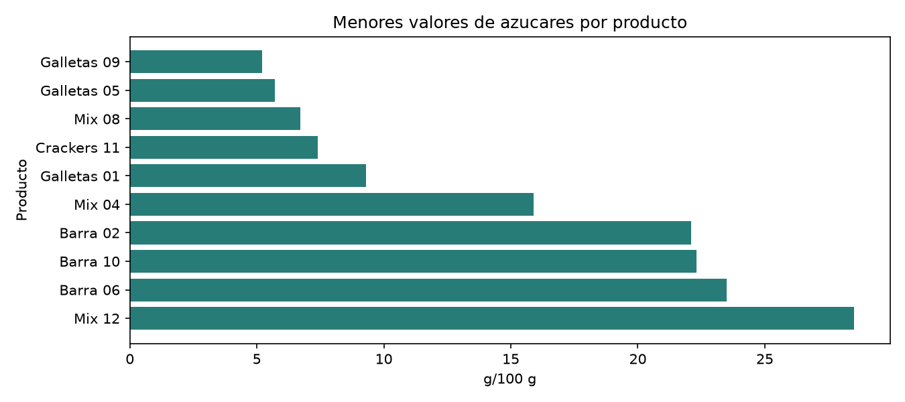

# Comparador de etiquetas nutricionales

**Autor:** Santiago Narbe  
**Materia:** Programación Orientada a Datos  
**Trabajo:** TP2 individual

## 3. Instalación y ejecución

Clona el repositorio y entra en `proyecto/`, donde se encuentran `requirements.txt`, `src/` y `tests/`:

```bash
git clone https://github.com/santinarbe-blip/TP-2-Santiago-Narbe-Nutricion.git
cd TP-2-Santiago-Narbe-Nutricion/proyecto
python -m venv .venv
source .venv/bin/activate
pip install -r requirements.txt
```

En Windows, activa el entorno con `.venv\Scripts\activate` en lugar de `source .venv/bin/activate`.

### Ejecutar la aplicación

La categoría debe ser una de estas opciones: `Cereales`, `Bebidas`, `Lácteos`, `Snacks` o `Conservas`.

```bash
python -m src.main --entrada data/productos.csv --categoria Snacks
python -m src.main --entrada data/productos.json --categoria Snacks
```

La ejecución crea `outputs/` con tablas, filas rechazadas y gráficos. Para omitir los gráficos, agrega `--sin-graficos`.

### Ejecutar las pruebas

```bash
python -m unittest discover -s tests -v
```

## 1. Problema y solución

Comparar la información nutricional de productos requiere usar la misma base de referencia. Las etiquetas pueden expresar cantidades de formas distintas y un dato ausente no significa que el nutriente esté presente en cantidad cero. Esta aplicación organiza fichas simuladas y compara nutrientes expresados por cada 100 gramos. Los valores ausentes se muestran como “no disponible”; los registros con identificadores incompletos o valores imposibles se informan aparte.

La herramienta está pensada para una persona que explora etiquetas con fines educativos. Permite filtrar por categoría, ordenar por un nutriente, revisar resúmenes por categoría y exportar resultados. No clasifica alimentos como saludables o no saludables, no recomienda dietas y no reemplaza asesoramiento profesional.

### Preguntas que permite explorar

1. Dentro de una categoría, ¿qué productos tienen menos azúcares, sal o energía por 100 g?
2. ¿Cómo varían los promedios de azúcares, fibra y proteínas entre categorías?
3. ¿Qué campos tienen datos no disponibles y qué registros se rechazan por identificadores o cantidades imposibles?
4. ¿Se obtiene la misma tabla al leer el mismo conjunto desde CSV y JSON?

Los resultados describen únicamente este conjunto sintético; no permiten generalizar a productos reales ni determinar por sí solos la calidad global de un alimento.

## 2. Datos y procedencia

`data/productos.csv` y `data/productos.json` son dos representaciones equivalentes de un conjunto creado para este trabajo mediante `src/generar_datos.py`, con semilla fija. Incluyen 60 productos analizables (con cuatro nutrientes ausentes deliberadamente) y 2 registros inválidos para demostrar el tratamiento de errores. No se usan datos personales ni una fuente externa. La generación, el esquema, las unidades y las limitaciones están documentados en [data/README.md](data/README.md).

Cada fila representa una ficha de producto. Se utilizan código EAN como texto, nombre, categoría, energía en kcal/100 g y nutrientes en g/100 g. El código se valida con una expresión regular para EAN de 8 o 13 dígitos; esto valida el formato, no el dígito de control.

## 4. Flujo de procesamiento

El flujo de procesamiento es:

**leer → inspeccionar y validar → limpiar y transformar → analizar → comunicar**

| Etapa | Qué hace | Dónde está |
|---|---|---|
| Leer | Carga CSV o JSON y convierte cada fila/objeto en un registro con la misma estructura. | `src/fuentes.py` |
| Inspeccionar y validar | Comprueba campos obligatorios, formato del código, valores numéricos y rangos de plausibilidad. | `src/pipeline.py` |
| Limpiar y transformar | Rechaza registros inválidos y códigos duplicados; normaliza nutrientes a números y conserva los faltantes como nulos. | `src/pipeline.py` |
| Analizar | Filtra por categoría, ordena por el nutriente elegido y calcula resúmenes por categoría. | `src/pipeline.py` |
| Comunicar | Imprime la comparación en consola y exporta tablas, faltantes, rechazos y gráficos. | `src/main.py`; archivos en `outputs/` por defecto |

El directorio de resultados se puede cambiar con `--salida`. Los nutrientes ausentes se representan como “no disponible” en las salidas que muestran valores y se excluyen solo de los cálculos que requieren ese dato. El motivo de cada registro rechazado queda en `outputs/rechazos.csv`; las cantidades faltantes por campo se guardan en `outputs/faltantes.csv`.

Los valores vacíos nunca se convierten en cero. Se rechazan nutrientes negativos, por encima de 100 g/100 g, energía por encima de 900 kcal/100 g, azúcares mayores que carbohidratos o grasas saturadas mayores que grasas totales. Son reglas de plausibilidad para este ejercicio, no una validación regulatoria de etiquetado.

## Otros ejemplos de uso

```bash
python -m src.main --entrada data/productos.csv --nutriente azucares
python -m src.main --entrada data/productos.json --categoria Snacks --nutriente azucares
python -m src.main --entrada data/productos.csv --nutriente sal --sin-graficos
python -m src.generar_datos
```

Las opciones disponibles son `energia`, `proteinas`, `carbohidratos`, `azucares`, `grasas`, `grasas_saturadas`, `fibra` y `sal`. `--salida` permite cambiar la carpeta de resultados y `--sin-graficos` evita generar imágenes.

## 8. Ejemplo de resultado

Esta es la salida real de `python -m src.main --entrada data/productos.csv --categoria Snacks --nutriente azucares --sin-graficos`, ejecutado desde `proyecto/`:

```text
Registros leídos: 62
Productos válidos: 60
Filas rechazadas: 2
Productos comparados: 12

Ordenados por azucares (menor a mayor):
       codigo      nombre categoria  azucares_g_100g
2000000000045 Galletas 09    Snacks              5.2
2000000000041 Galletas 05    Snacks              5.7
2000000000044      Mix 08    Snacks              6.7
2000000000047 Crackers 11    Snacks              7.4
2000000000037 Galletas 01    Snacks              9.3
2000000000040      Mix 04    Snacks             15.9
2000000000038    Barra 02    Snacks             22.1
2000000000046    Barra 10    Snacks             22.3
2000000000042    Barra 06    Snacks             23.5
2000000000048      Mix 12    Snacks             28.5
2000000000043 Crackers 07    Snacks             32.6
2000000000039 Crackers 03    Snacks             35.4
```

### Gráficos

La aplicación guarda las imágenes en `outputs/` y respeta la categoría seleccionada. Los gráficos de barras muestran hasta diez productos con valores disponibles, ordenados de menor a mayor. Este ejemplo fue generado por la misma ejecución con categoría `Snacks` y criterio `azucares`:



Las barras más largas indican más gramos de azúcares cada 100 g dentro de los productos comparados; no determinan por sí solas si un producto es saludable. Los valores ausentes se excluyen del gráfico, no se convierten en cero. En la tabla de comparación, cuando corresponde, se muestran como “no disponible”.

- `grafico_energia.png`: barras horizontales; eje X en kcal/100 g y eje Y con el producto. Una barra menor indica menos energía declarada por 100 g en este conjunto; no es una evaluación global del alimento.
- `grafico_azucares.png`: barras horizontales; eje X en g/100 g y eje Y con el producto. Una barra menor indica menos azúcares por 100 g en los productos comparados.
- `grafico_azucares_vs_grasas.png`: dispersión; eje X en azúcares (g/100 g) y eje Y en grasas totales (g/100 g). Los puntos muestran productos con ambos datos disponibles; proximidad no implica causalidad.
- `grafico_datos_faltantes.png`: barras horizontales; eje X con la cantidad de registros y eje Y con el campo. Una barra mayor indica que ese dato está menos disponible, no que su valor sea cero.

## 5. Organización del código

```text
proyecto/
├── README.md
├── requirements.txt
├── .gitignore
├── data/
│   ├── README.md
│   ├── productos.csv
│   ├── productos.json
│   └── ventas.csv
├── src/
│   ├── __init__.py
│   ├── fuentes.py
│   ├── generar_datos.py
│   ├── main.py
│   ├── modelo.py
│   └── pipeline.py
├── tests/
│   ├── README.md
│   └── test_pipeline.py
├── docs/
│   └── ejemplo_azucares_snacks.png
└── outputs/  # se crea al ejecutar; sus resultados no se versionan
```

`FuenteDatos`, `FuenteCSV` y `FuenteJSON` normalizan el acceso a los archivos. `ProductoNutricional` representa una ficha y da acceso a sus nutrientes. `pipeline.py` valida, limpia y compara; `main.py` coordina argumentos, exportaciones y gráficos. La generación de gráficos está implementada en `main.py`, por eso todavía no hay un módulo `graficos.py`. `outputs/` se crea al ejecutar la aplicación y está excluido de Git por `.gitignore`; sus archivos no forman parte de los datos versionados del proyecto.

## 6. Conceptos del curso aplicados

- **Funciones con una responsabilidad:** `fuente_desde_ruta` selecciona el lector según la extensión; `FuenteCSV.cargar` y `FuenteJSON.cargar` leen sus formatos; `normalizar_ficha` valida y convierte un registro; `limpiar_productos` separa productos válidos y rechazos; `comparar_etiquetas` filtra y ordena la comparación; `resumir_faltantes` y `resumir_categorias` calculan resúmenes. En `main.py`, `construir_parser` define los argumentos, `generar_graficos` crea las figuras y `main` coordina la ejecución y exportación.
- **Clase de dominio:** `ProductoNutricional`, definida como dataclass inmutable en `src/modelo.py`, tiene los atributos `codigo`, `nombre`, `categoria`, `energia_kcal_100g`, `proteinas_g_100g`, `carbohidratos_g_100g`, `azucares_g_100g`, `grasas_g_100g`, `grasas_saturadas_g_100g`, `fibra_g_100g` y `sal_g_100g`. Los valores nutricionales aceptan `float` o `None` cuando están ausentes. Sus métodos `obtener_nutriente` y `como_registro` permiten consultar un nutriente y convertir la ficha a diccionario.
- **Abstracción de fuentes:** `FuenteDatos.cargar(ruta)` define la interfaz que implementan `FuenteCSV` y `FuenteJSON`. Ambas devuelven una lista de diccionarios para que el pipeline pueda procesar los datos sin depender del formato de origen.
- **Expresión regular:** `src/pipeline.py` usa `(?:\d{8}|\d{13})\Z` para validar que el código contenga exactamente 8 o 13 dígitos. Los códigos se conservan como texto. La validación no comprueba que el código exista ni verifica su dígito de control.
- **Validaciones y errores:** se comprueban los campos de identificación requeridos, que nombre y categoría no estén vacíos, que los nutrientes sean números finitos dentro de rangos permitidos y que no sean negativos. También se rechazan azúcares por encima de carbohidratos, grasas saturadas por encima de grasas totales, códigos duplicados y códigos que no cumplen el formato. Los errores de registros inválidos incluyen un motivo comprensible en `outputs/rechazos.csv`; no se validan fechas porque el esquema no contiene campos de fecha.

## 7. Decisiones de limpieza

| Situación | Decisión | Justificación |
|---|---|---|
| Código inválido | Se rechaza la fila y se registra el motivo en `outputs/rechazos.csv`. | El código es obligatorio para identificar cada producto y detectar duplicados; un formato inválido impide una identificación consistente. |
| Nutriente faltante | Se conserva como nulo y se muestra como “no disponible”, nunca como 0. Se omite solo de los cálculos que requieren ese valor. | Un dato ausente no demuestra que el nutriente tenga valor cero; convertirlo sesgaría las comparaciones y los promedios. |
| Código duplicado | Se conserva la primera fila válida; las filas posteriores con ese código se rechazan y se registran. No se intenta elegir la más completa ni combinar registros. | Mantiene una sola ficha por código con una regla determinista y evita fusionar datos potencialmente incompatibles. |
| Valor fuera de rango o inconsistente | Se rechaza la fila completa y se registra el motivo. Se consideran inválidos los nutrientes negativos o mayores a 100 g/100 g, la energía mayor a 900 kcal/100 g, los valores no numéricos o no finitos, los azúcares mayores que los carbohidratos y las grasas saturadas mayores que las grasas totales. | Evita modificar o imputar valores y limita el análisis a registros que cumplen las reglas de plausibilidad definidas para este ejercicio. No son umbrales regulatorios. |

## Pruebas y reproducibilidad

Ejecuta `python -m unittest discover -s tests`. Las pruebas cubren una comparación normal, filas inválidas y duplicadas, faltantes y equivalencia entre CSV y JSON. El generador usa una semilla fija para volver a crear el mismo conjunto. Las dependencias y el comando están especificados en `requirements.txt`.

## 9. Interpretación y limitaciones

### Qué se puede concluir

- La aplicación carga los mismos registros desde CSV y JSON, descarta filas que no cumplen las validaciones y permite ordenar los productos válidos de una categoría por el nutriente elegido, expresado por cada 100 g.
- Para este conjunto fijo, se pueden describir las diferencias entre los valores generados y localizar datos faltantes. Por ejemplo, en el ejemplo de Snacks, Galletas 09 tiene el menor valor disponible de azúcares (5,2 g/100 g) entre los 12 productos comparados.
- Los resúmenes y gráficos describen únicamente los registros válidos incluidos; los faltantes no se imputan como cero.

### Qué no se puede concluir

- Los datos son sintéticos: no describen productos reales ni permiten generalizar al mercado o a una categoría completa.
- El orden por un nutriente no determina si un alimento es saludable, adecuado para una persona o preferible en general. No permite hacer recomendaciones médicas o dietarias.
- No se pueden atribuir diferencias a causas, evaluar cambios en el tiempo ni hacer inferencias estadísticas sobre una población. La energía también es un cálculo derivado de los nutrientes simulados, no una medición independiente.
- Los rangos y reglas de validación son didácticos; no certifican que un producto cumpla regulaciones de etiquetado.

### Posibles mejoras futuras

- Sustituir o complementar los datos sintéticos con una fuente documentada de productos reales, respetando su licencia y registrando la fecha de consulta.
- Incorporar más productos, categorías y variables; documentar la cobertura y analizar patrones de datos faltantes.
- Añadir filtros y comparaciones entre varios nutrientes, selección de porciones y gráficos con mejor manejo de faltantes.
- Separar la generación de gráficos en `src/graficos.py` y agregar pruebas específicas para exportaciones y visualizaciones.

La aplicación actual compara datos por 100 g para una categoría y un nutriente a la vez. No convierte porciones, no verifica normas locales, no consulta productos en línea y no realiza recomendaciones dietarias. Las categorías son simplificadas y no exhaustivas.
